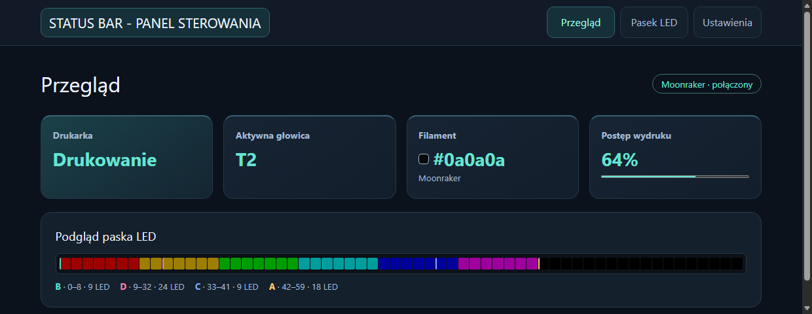
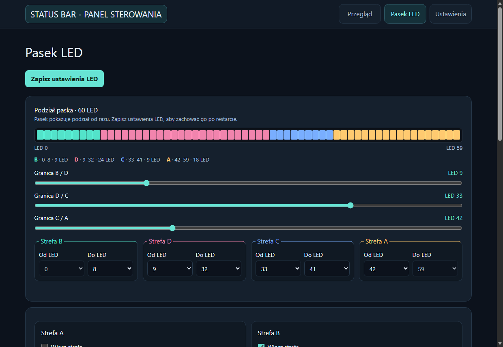
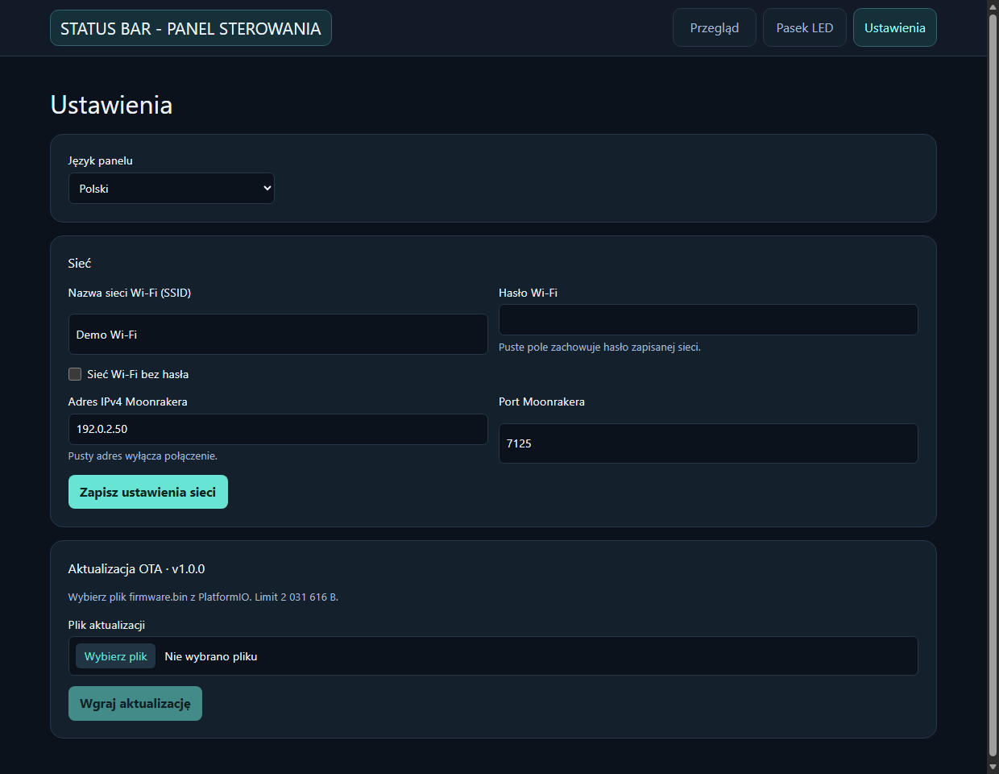

# Snapmaker_U1_Status_Bar v1.0.0

**Polski** | [English](README.md)

[Wydanie stabilne v1.0.0](https://github.com/wlodeka/Snapmaker-U1-Status-Bar/releases/tag/v1.0.0)

Lokalny pasek stanu dla Snapmakera U1.
Do zastosowania w dowolnej zabudowie (np. między górą Snapmaker U1 , a TopCover / Odsyłam do licznych projektów DIY na platformach z modelami 3D),
z preferencją zastosowania strefy 'A' do oświetlenia wnętrzna komory Snapmaker U1.
Firmware działa na Waveshare ESP32-S3-Zero
(2×9 pinów, ESP32-S3FH4R2) i steruje 60 diodami SK6812 RGBNW w kolejności GRBW,
800 kHz - Długość paska LED 100cm. Panel WWW jest wbudowany w firmware. Moonraker udostępnia telemetrię
przez WebSocket i JSON-RPC tylko do odczytu.

W **Ustawienia → Język panelu** wybierz **Polski** lub **English**. Panel
przełącza język bez odświeżania strony, a ESP32 pamięta wybór po restarcie.
Domyślnie panel jest po polsku.

## Podłączenie paska LED i ESP32-S3

|Strefa|Domyślnie|Liczba LED|
| -- | --- | --: |
| B | 0–8 | 9  |
| D | 9–32 | 24  |
| C | 33–41 | 9  |
| A | 42–59 | 18  |

- Zasil pasek ze stabilizowanego źródła 5 V dobranego do maksymalnego prądu
  paska. Dla opisanego montażu przewidziano około 2 A.
  [Zalecenia dotyczące podłączenia paska](https://learn.adafruit.com/adafruit-neopixel-uberguide/best-practices)
- Połącz wejście **DIN** paska z pinem oznaczonym **4** (**GPIO4**) na płytce
  ESP32-S3-Zero przez rezystor 330 Ω.
  Jeśli używasz innego pinu, zmień `U1_LED_GPIO` w `platformio.ini`.
  GPIO21 obsługuje diodę na płytce.
- Przy zasilaniu ESP32-S3-Zero przez piny użyj oznaczeń **5V** i **GND**.
  Połącz masę płytki i paska. [Rozkład pinów Waveshare](https://docs.waveshare.com/ESP32-S3-Zero?variant=ESP32-S3-Zero#pinout)

## Strefy LED w panelu

W sekcji **Pasek LED → Podział paska** widać wszystkie 60 diod w kolejności
od LED 0 do LED 59. Trzy suwaki zmieniają wspólne granice B/D, D/C i C/A.
Można też wybrać dokładne indeksy z list **Od LED** i **Do LED**. Zmiana
jednego końca przesuwa granicę sąsiedniej strefy. Strefy pokrywają cały pasek,
każda ma co najmniej jedną diodę, a ich kolejność pozostaje B, D, C, A.

Podczas zmiany zakresu podział aktualizuje się w panelu, a fizyczny pasek
na chwilę wyświetla kolory stref. Podświetlenie podziału jest ograniczone do
12% i uwzględnia limity stref, w tym limit 0%. Po zakończeniu podglądu
wracają wybrane kolory, animacje i stan włączenia stref. Kliknij
**Zapisz ustawienia LED**, aby zachować także nowy podział po restarcie. **Przegląd**
pokazuje klatki wysyłane na pasek, z rozjaśnieniem kolorów na ekranie.

Każda strefa A, B, C i D ma własne włączanie, jasność, limit jasności,
kolor oraz wybór animacji, szybkości i kierunku. Limit mnoży jasność
tylko swojej strefy. Przykładowo jasność 50% przy limicie 80% daje do 40%
pełnej jasności przed uwzględnieniem animacji. Efekt **Statyczna** w strefach
B i C dodatkowo mnoży tę jasność przez 0,8. Opcja **Kolor z Moonrakera**
używa koloru aktywnej głowicy w gotowości i podczas drukowania, a w pozostałych
stanach wybiera kolor sygnalizacyjny. Aby ustawić własny kolor, wyłącz tę
opcję, wybierz **Kolor ręczny** i kliknij **Zapisz ustawienia LED**.
W strefie A wyłącz też **Użyj kanału białego RGBW**, jeśli chcesz wybrać RGB.
Po włączeniu kanału białego strefa A zachowuje trzy dotychczasowe odcienie bieli.

Gdy Moonraker podaje czarny lub szary kolor aktywnego filamentu, włączone
strefy korzystające z **Koloru z Moonrakera** pokazują płynnie przesuwającą
się tęczę. Dotyczy to m.in. `#000000`, `#0A0A0A` i `#808080`, również szarości
z lekkim zabarwieniem. Biel i odcienie bliskie bieli zachowują swój kolor.
W przypadku ciemnych kolorowych filamentów firmware zachowuje proporcje RGB
i koryguje poziom sygnału przed zastosowaniem jasności i limitu strefy.
Panel nadal pokazuje kolor zgłoszony przez drukarkę.

Aby włączyć tęczę ręcznie, wyłącz **Kolor z Moonrakera**, zaznacz
**Tęcza** w wybranych strefach i kliknij **Zapisz ustawienia LED**.
Kolory tęczy przesuwają się wzdłuż całego paska w cyklu 3,2 s. Dwie płynnie
przesuwające się fale jasności pomagają zobaczyć ruch przy niskich ustawieniach.
Każda strefa zachowuje swoją jasność i limit. Wybrana animacja wraca po wyłączeniu tęczy.

W animacjach ciemne fragmenty mogą gasnąć, a jasne dochodzą do ustawionego limitu
strefy. Dodatkowe efekty to **Pościg**, **Rozbłysk od środka**, **Iskry** i
**Zalewanie**. Zapisane efekty zachowują swoje numery w ustawieniach.

Domyślna animacja strefy D jest jednolita podczas gotowości i drukowania,
z pulsowaniem przy błędzie. Strefa A uruchamia się z efektem statycznym
i dotychczasowym odcieniem bieli.

**Zapisz ustawienia LED** zapisuje w pamięci ESP32 cały podział paska, jasność
i limity stref, ręczną tęczę, ustawienia koloru i animacji oraz kolory zapasowe.
Po restarcie firmware odtwarza ostatni zapis z nowego wpisu `led_v3` w NVS.
Konfiguracja Wi-Fi i Moonrakera zachowuje dotychczasowy zapis.

## Pierwsze uruchomienie

1. Pobierz ZIP ze źródłami z wydania stabilnego, rozpakuj go i otwórz projekt
   w VS Code z PlatformIO. W Windows zastąp `COMxx` w pliku `platformio.ini`
   portem płytki w obu wpisach `upload_port` i `monitor_port`. W innych systemach
   usuń te dwa wpisy, aby PlatformIO samo wykryło port. W środowisku
   `u1_status_bar` wykonaj **Build**, następnie **Upload** przez USB-C. Aby
   ręcznie wejść w tryb wgrywania, przytrzymaj BOOT przy podłączaniu USB.
   Po wgraniu uruchom płytkę ponownie.
2. Połącz się z otwartą siecią `U1-Status-XXXXXX`. Nazwa sieci i adres panelu
   pojawiają się w **Serial Monitor** (115200) po uruchomieniu AP. Jeśli Android
   ma zapisany profil tej sieci z v0.1, wybierz **Zapomnij** i połącz się ponownie.
   Jeśli telefon zgłosi brak internetu, pozostań połączony z AP.
   [Pomoc Google Pixel](https://support.google.com/pixelphone/answer/6183600)
3. Otwórz `http://192.168.4.1/`. Panel działa bez logowania. W **Ustawienia → Sieć**
   wpisz SSID i hasło domowej sieci 2,4 GHz oraz lokalny adres IPv4 drukarki
   i port Moonrakera, domyślnie 7125. Przy zmianie pozostałych ustawień puste
   pole hasła Wi-Fi zachowuje hasło zapisane dla tego samego SSID.
4. Po uzyskaniu adresu DHCP firmware zapisze konfigurację w NVS i wyłączy AP
   po 10 sekundach. Połącz telefon lub komputer ze swoją siecią i użyj adresu
   IPv4 ESP32 wyświetlonego w panelu konfiguracji lub monitorze szeregowym.

Panel jest przeznaczony do zaufanej sieci lokalnej. Każdy, kto ma dostęp do
panelu, może zmieniać ustawienia bez logowania. W domowej sieci Wi-Fi dostępna
jest w ten sam sposób aktualizacja firmware’u. Nie udostępniaj adresu ani portu
panelu w internecie.

Jeśli zapisanej sieci zabraknie na co najmniej 60 sekund, ESP32 udostępni
ten sam otwarty AP do odzyskania dostępu i będzie nadal próbować połączyć się
z zapisaną siecią. Nieudana zmiana Wi-Fi zachowuje poprzednie dane. Gdy
urządzenie znów uzyska adres w sieci domowej, wyłączy AP po 10 sekundach
i wróci do trybu STA.

Przy aktualizacji z v0.1 firmware przenosi zapisane dane domowego Wi-Fi
i adres oraz port Moonrakera do nowego wpisu w NVS. Po udanym zapisie usuwa
stary wpis wraz z hasłem panelu.

Gdy operacja panelu się nie powiedzie, komunikat podaje endpoint i typ błędu.
W `Serial Monitor` przy 115200 widać odczyty ustawień i wyniki zapisów.
Podczas zmiany Wi-Fi odpowiedź `202` oznacza rozpoczęcie sprawdzania połączenia.
Potwierdzenie zapisu pojawia się po uzyskaniu adresu i zapisie do NVS.

## Aktualizacja OTA

Użyj OTA, jeśli zainstalowane oprogramowanie ma opcję aktualizacji w panelu.
Gdy tej opcji brakuje lub starsza wersja regularnie przerywa przesyłanie,
wgraj v1.0.0 przez USB według instrukcji pierwszego uruchomienia.
Wersja v1.0.0 pozwala na przerwę do 2 s w trakcie odbioru zaakceptowanego obrazu.
Przy przerwanym transferze monitor szeregowy pokazuje liczbę odebranych bajtów.

1. Zbuduj kolejną wersję poleceniem **Build** i znajdź plik
   `.pio/build/u1_status_bar/firmware.bin`.
2. Otwórz panel przez adres IPv4 ESP32 w domowej sieci i przejdź do
   **Ustawienia → Aktualizacja OTA**. Wybierz plik i kliknij **Wgraj aktualizację**.
   Wgrywanie odbywa się bez hasła i jest dostępne w trybie STA.
3. Gdy panel potwierdzi zapis, ESP32 uruchomi się ponownie. Odśwież panel
   i sprawdź numer wersji w **Ustawienia → Aktualizacja OTA**.

ESP32 zapisuje obraz w nieaktywnej partycji, a aktywuje ją po weryfikacji.
[Układ partycji ESP-IDF](https://docs.espressif.com/projects/esp-idf/en/v4.4.7/esp32s3/api-reference/system/ota.html#ota-process-overview)

## Moonraker i dane U1

- Firmware subskrybuje `print_stats.state`, `toolhead.extruder`,
  `virtual_sdcard.progress` oraz trzy pola `print_task_config`. Zadanie
  FreeRTOS obsługuje połączenie i ponawianie niezależnie od paska i panelu.
  Wymagany jest dostęp z sieci lokalnej do `ws://IP:PORT/websocket`, zgodny
  z fabryczną konfiguracją U1 dla zaufanych klientów. Połączenie odbywa się
  bez klucza API.
  [Konfiguracja Moonrakera w U1](https://github.com/Snapmaker/u1-moonraker/blob/main/lava/moonraker.conf)
- Fabryczny Klipper U1 mapuje 32 logiczne narzędzia wewnętrznie i publikuje
  fizyczną głowicę jako `extruder`, `extruder1`, `extruder2` lub
  `extruder3`. Jeśli wariant firmware zwróci rozszerzoną nazwę `extruder4`–`extruder31`,
  kod użyje `extruder_map_table` wyłącznie podczas drukowania lub pauzy, jeśli
  `extruders_used` potwierdza docelową głowicę. Bez tych danych lub przy
  nieznanej nazwie panel pokazuje kreskę, a strefa D w trybie automatycznym
  używa koloru stanu.
  [Kod głowicy U1](https://github.com/Snapmaker/u1-klipper/blob/main/klippy/toolhead.py)
- `filament_color_rgba` zawiera cztery ciągi `RRGGBBAA` przypisane do
  głowic fizycznych. Do LED trafiają kanały RGB. Przy braku poprawnego koloru
  w trybie automatycznym używany jest kolor zapasowy danej głowicy.
  `FFFFFFFF` jest prawidłową bielą i wartością domyślną U1, więc
  sam ciąg nie pozwala rozróżnić tych dwóch przypadków.
  [Kod konfiguracji zadania U1](https://github.com/Snapmaker/u1-klipper/blob/main/klippy/extras/print_task_config.py)
- Anulowanie i błąd są rozróżniane przez stany `cancelled` i `error`.
  Jeśli inna wersja firmware raportuje anulowanie wyłącznie jako `error`,
  panel pokaże błąd zgodnie z odebraną wartością.
  [Stany zadania w U1](https://github.com/Snapmaker/u1-klipper/blob/main/klippy/extras/print_stats.py)

## Pliki i zależności

- `platformio.ini`, `boards/`, `partitions.csv` – PlatformIO Espressif32
  6.12.0, Arduino-ESP32 2.0.17, 4 MB Flash QIO 80 MHz, 2 MB PSRAM QSPI
  (`qio_qspi`) i dwie partycje programu OTA po 2 031 616 bajtów.
  [Dokumentacja Waveshare](https://docs.waveshare.com/ESP32-S3-Zero?variant=ESP32-S3-Zero)
- `src/settings.*`, `src/network.*`, `src/moonraker.*` – konfiguracja NVS,
  Wi-Fi i telemetria.
- `src/leds.*`, `src/web.*`, `src/main.cpp` – pasek RGBW i animacje, panel
  i uruchomienie modułów.
- `web/panel.html` – panel WWW (HTML, CSS i JS). Przy buildzie
  `scripts/panel_page.py` kompresuje go gzipem i osadza w firmware.
- `src/ota.cpp`, `scripts/ota_upload.py` – odbiór aktualizacji i właściwy adres
  metadanych OTA podczas pierwszego wgrania przez USB.
- Biblioteki `Adafruit NeoPixel 1.12.5`, `WebSockets 2.7.2`,
  `ArduinoJson 6.21.5`. [Informacje licencyjne](THIRD_PARTY_NOTICES.md)
- `test/` — testy parserów, zapisu LED i migracji ustawień sieci. Na komputerze
  uruchomisz je poleceniem `pio test -e native`.
- `.github/workflows/firmware.yml` – testy i build przy każdym PR i pushu na
  `main`. Wydanie v1.0.0 zawiera kod źródłowy. Plik `firmware.bin`
  powstaje po kompilacji w PlatformIO.

Przy pierwszej kompilacji sprawdź log PlatformIO pod kątem rozpoznania lokalnej
definicji płytki, rozwiązania wersji bibliotek, zgodności API i rozmiaru obrazu
w partycji OTA (2 031 616 bajtów). Po późniejszym wgraniu odczytaj
rozmiary Flash i PSRAM w monitorze szeregowym, sprawdź kolejność GRBW oraz odczyt
głowicy i koloru przy wydruku z mapowaniem narzędzi. Kompilacja i próby na sprzęcie
pozostają do ręcznego wykonania.

## Panel WWW

Zrzuty panelu z przykładowymi danymi.

## Źródła i wkład

Za poprawki panelu i automatycznych testów dziękuję użytkownikowi
`@upgreydd`. [Profil na GitHubie](https://github.com/upgreydd)

Jako referencje techniczne wykorzystano dokumentację Moonrakera, źródła U1
i opis telemetrii oraz układu RGBW w projekcie coroNET OS 2. Implementacja jest
własna. [Moonraker](https://moonraker.readthedocs.io/en/latest/external_api/printer/#subscribe-to-printer-object-status-updates)
[coroNET OS 2](https://github.com/AlphaStudioDE/coroNET_OS_2/blob/main/ASSEMBLY.md#led-layout)
