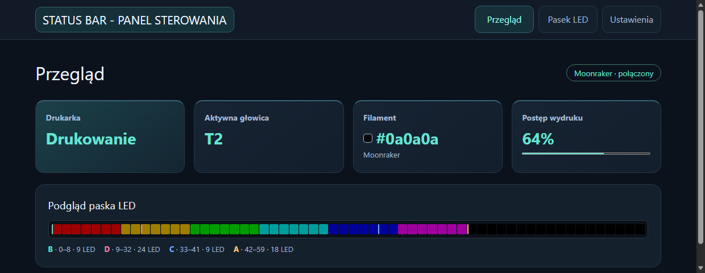
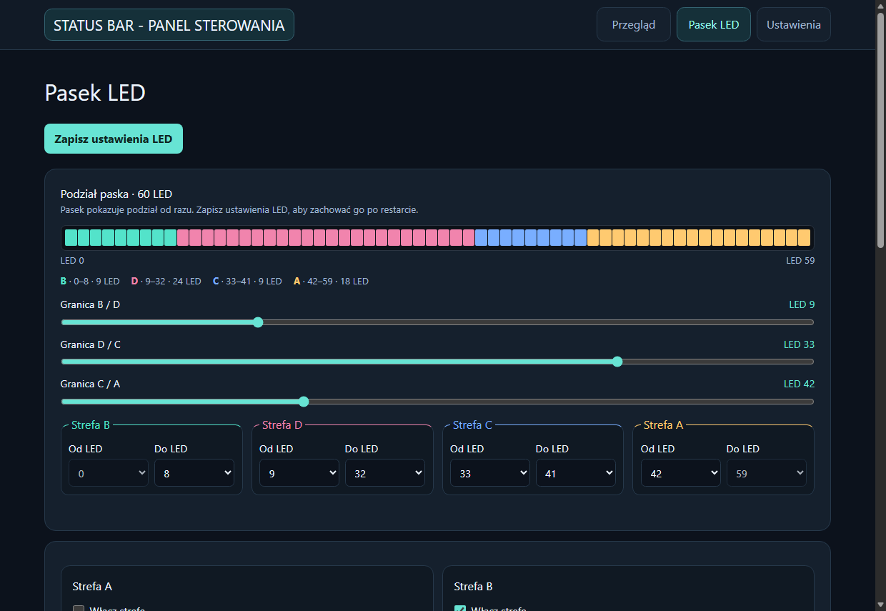
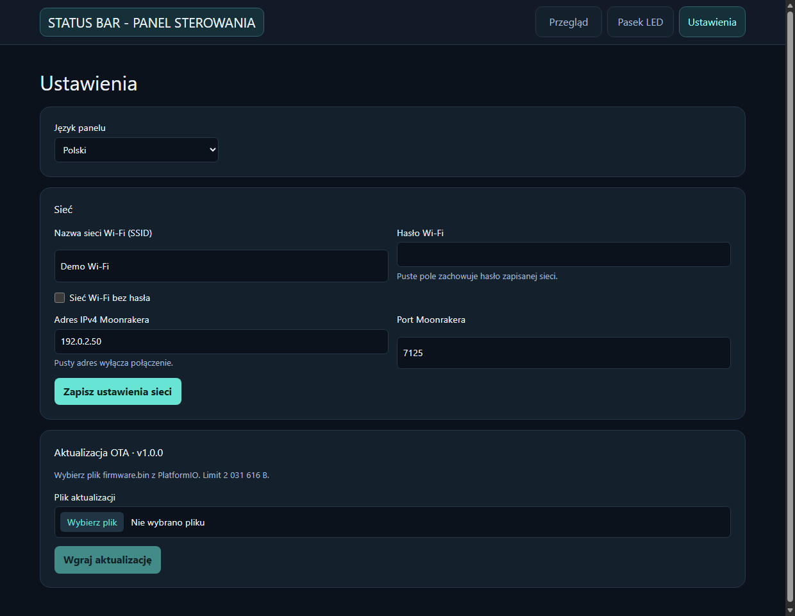

# Snapmaker_U1_Status_Bar v1.0.0

**English** | [Polski](README.PL.md)

[Stable release v1.0.0](https://github.com/wlodeka/Snapmaker-U1-Status-Bar/releases/tag/v1.0.0)

A local status bar for the Snapmaker U1.
It fits any enclosure build (for example between the top of the Snapmaker U1 and a TopCover; see the many DIY
designs on 3D model platforms). Zone 'A' is intended to light the inside of the Snapmaker U1 chamber.
The firmware runs on a Waveshare ESP32-S3-Zero
(2×9 pins, ESP32-S3FH4R2) and drives 60 SK6812 RGBNW LEDs in GRBW order at
800 kHz, on a 100 cm strip. The web panel is built into the firmware. Moonraker provides telemetry
over WebSocket and read-only JSON-RPC.

In **Settings → Panel language** choose **Polski** or **English**. The panel
switches language without reloading the page, and the ESP32 remembers the choice
after a restart. The panel is in Polish by default.

## Wiring the LED strip and the ESP32-S3

|Zone|Default|LED count|
| -- | --- | --: |
| B | 0–8 | 9  |
| D | 9–32 | 24  |
| C | 33–41 | 9  |
| A | 42–59 | 18  |

- Power the strip from a regulated 5 V supply sized for the strip's maximum
  current. About 2 A is planned for the described build.
  [Strip wiring best practices](https://learn.adafruit.com/adafruit-neopixel-uberguide/best-practices)
- Connect the strip's **DIN** input to the ESP32-S3-Zero pad labeled **4**
  (**GPIO4**) through a 330 Ω resistor.
  If you use another pin, change `U1_LED_GPIO` in `platformio.ini`.
  GPIO21 drives the on-board LED.
- When powering the ESP32-S3-Zero through its pins, use the pads labeled **5V**
  and **GND**. Connect the board and strip grounds together.
  [Waveshare pinout](https://docs.waveshare.com/ESP32-S3-Zero?variant=ESP32-S3-Zero#pinout)

## LED zones in the panel

**LED strip → Strip layout** shows all 60 LEDs in order from LED 0 to LED 59.
Three sliders move the shared B/D, D/C and C/A boundaries. You can also pick
exact indexes from the **From LED** and **To LED** lists. Changing one end of a
zone moves the boundary of the neighbouring zone. The zones always cover the
whole strip, each has at least one LED, and their order stays B, D, C, A.

While you change a range, the layout updates in the panel and the physical strip
briefly shows the zone colors. The layout preview is limited to 12% brightness
and respects the zone limits, including a 0% limit. After the preview, the chosen
colors, animations and zone on/off states come back. Click **Save LED settings**
to also keep the new layout after a restart. **Overview** shows the frames sent
to the strip, with colors brightened on screen.

Each zone A, B, C and D has its own on/off switch, brightness, brightness limit,
color, and choice of animation, speed and direction. The limit multiplies the
brightness of its own zone only. For example, 50% brightness with an 80% limit
gives up to 40% of full brightness before the animation is applied. In zones B
and C, the **Static** effect applies an additional factor of 0.8.
**Color from Moonraker** uses the active toolhead's color in standby and while
printing, and a signal color in other states. To set your own color, turn this
option off, choose **Manual color** and click **Save LED settings**.
In zone A also turn off **Use the RGBW white channel** if you want to pick an RGB color.
With the white channel on, zone A keeps the three existing white tones.

When Moonraker reports a black or gray active filament color, enabled zones
that use **Color from Moonraker** show a smoothly moving rainbow. Examples
include `#000000`, `#0A0A0A`, `#808080`, and slightly tinted grays. White and
near-white keep their color. The firmware preserves the RGB ratios of dark
chromatic colors and raises their signal before applying the zone brightness
and limit. The web panel still shows the color reported by the printer.

To turn the rainbow on manually, turn off **Color from Moonraker**, tick
**Rainbow** in the chosen zones and click **Save LED settings**. The colors
move along the whole strip in a 3.2-second cycle. Two fading bands help make
the motion visible at low brightness. Each zone keeps its own brightness and
limit. The chosen animation returns when the rainbow is off.

In animations, dark parts can fade out and bright parts reach the zone's limit.
Extra effects are **Chase**, **Center burst**, **Sparkle** and **Wipe**. Saved
effects keep their numbers in the settings.

By default zone D is solid in standby and while printing, and pulses on error.
Zone A starts with the static effect and the existing white tone.

**Save LED settings** stores the whole layout, zone brightness and limits, manual
rainbow, color and animation settings, and fallback colors in ESP32 memory.
After a restart the firmware restores the last save from the `led_v3` NVS entry.
The Wi-Fi and Moonraker configuration keeps its existing storage.

## First start

1. Download the source ZIP from the stable release, extract it and open the project
   in VS Code with PlatformIO. On Windows, replace `COMxx` in `platformio.ini`
   with the board's port for both `upload_port` and `monitor_port`. On other
   systems, remove those two placeholder lines to let PlatformIO detect the port.
   In the `u1_status_bar` environment, run **Build**, then **Upload** over USB-C.
   To enter upload mode manually, hold BOOT while plugging in USB. After uploading,
   restart the board.
2. Connect to the open network `U1-Status-XXXXXX`. The network name and panel
   address appear in the **Serial Monitor** (115200) when the AP starts. If Android
   has a saved profile for this network from v0.1, choose **Forget** and connect again.
   If the phone reports no internet, stay connected to the AP.
   [Google Pixel help](https://support.google.com/pixelphone/answer/6183600)
3. Open `http://192.168.4.1/`. The panel needs no login. In **Settings → Network**
   enter the SSID and password of your 2.4 GHz home network, the printer's local
   IPv4 address and the Moonraker port (7125 by default). When you change other
   settings, an empty Wi-Fi password field keeps the password saved for the same SSID.
4. Once it gets a DHCP address, the firmware saves the configuration in NVS and turns
   the AP off after 10 seconds. Connect your phone or computer to your network and use
   the ESP32's IPv4 address shown in the setup panel or the serial monitor.

The panel is intended for a trusted local network. Anyone who can reach it
can change settings without signing in. Firmware updates are also available
without sign-in when the device is on your local Wi-Fi. Keep the panel's
address and port off the public internet.

If the saved network is missing for at least 60 seconds, the ESP32 opens the same
open AP so you can get back in, and keeps trying to connect to the saved network.
A failed Wi-Fi change keeps the previous settings. When the device gets an address
on the home network again, it turns the AP off after 10 seconds and goes back to STA mode.

When updating from v0.1, the firmware moves the saved home Wi-Fi data and the
Moonraker address and port to a new NVS entry. After a successful save it deletes
the old entry together with the panel password.

When a panel action fails, the message shows the endpoint and the error type.
The `Serial Monitor` at 115200 shows settings reads and save results.
During a Wi-Fi change, a `202` response means the connection check has started.
The save is confirmed after the device gets an address and writes to NVS.

## OTA update

Use OTA when your installed firmware has an OTA option in the web panel.
If that option is missing or an older version repeatedly drops the upload,
install v1.0.0 over USB following the first-start instructions above.
Version v1.0.0 allows a gap of up to 2 seconds during an accepted OTA transfer.
The Serial Monitor reports how many bytes arrived if the transfer stops.

1. Build the new version with **Build** and find
   `.pio/build/u1_status_bar/firmware.bin`.
2. Open the panel at the ESP32's IPv4 address on your home network and go to
   **Settings → OTA update**. Choose the file and click **Upload update**.
   Uploading needs no password and is available in STA mode.
3. When the panel confirms the write, the ESP32 restarts. Reload the panel
   and check the version number in **Settings → OTA update**.

The ESP32 writes the image to the inactive partition and activates it after verification.
[ESP-IDF partition layout](https://docs.espressif.com/projects/esp-idf/en/v4.4.7/esp32s3/api-reference/system/ota.html#ota-process-overview)

## Moonraker and U1 data

- The firmware subscribes to `print_stats.state`, `toolhead.extruder`,
  `virtual_sdcard.progress` and three `print_task_config` fields. A FreeRTOS
  task handles the connection and retries independently of the strip and the panel.
  It needs local network access to `ws://IP:PORT/websocket`, which matches the
  stock U1 configuration for trusted clients. No API key is used.
  [U1 Moonraker configuration](https://github.com/Snapmaker/u1-moonraker/blob/main/lava/moonraker.conf)
- The stock U1 Klipper maps 32 logical tools internally and publishes the
  physical toolhead as `extruder`, `extruder1`, `extruder2` or `extruder3`.
  If a firmware variant returns an extended name `extruder4`–`extruder31`,
  the code uses `extruder_map_table` only while printing or paused, and only if
  `extruders_used` confirms the target toolhead. Without this data, or for an
  unknown name, the panel shows a dash and zone D in automatic mode uses the state color.
  [U1 toolhead code](https://github.com/Snapmaker/u1-klipper/blob/main/klippy/toolhead.py)
- `filament_color_rgba` holds four `RRGGBBAA` strings, one per physical toolhead.
  The RGB channels go to the LEDs. Without a valid color, automatic mode uses
  that toolhead's fallback color. `FFFFFFFF` is a valid white and also the U1
  default, so the string alone cannot tell these two cases apart.
  [U1 print task config code](https://github.com/Snapmaker/u1-klipper/blob/main/klippy/extras/print_task_config.py)
- Cancel and error are told apart by the `cancelled` and `error` states.
  If another firmware version reports a cancel only as `error`, the panel shows
  an error, matching the received value.
  [U1 print states](https://github.com/Snapmaker/u1-klipper/blob/main/klippy/extras/print_stats.py)

## Files and dependencies

- `platformio.ini`, `boards/`, `partitions.csv` – PlatformIO Espressif32
  6.12.0, Arduino-ESP32 2.0.17, 4 MB Flash QIO 80 MHz, 2 MB PSRAM QSPI
  (`qio_qspi`) and two OTA app partitions of 2,031,616 bytes each.
  [Waveshare documentation](https://docs.waveshare.com/ESP32-S3-Zero?variant=ESP32-S3-Zero)
- `src/settings.*`, `src/network.*`, `src/moonraker.*` – NVS configuration,
  Wi-Fi and telemetry.
- `src/leds.*`, `src/web.*`, `src/main.cpp` – RGBW strip and animations, panel
  and module startup.
- `web/panel.html` – the web panel (HTML, CSS and JS). At build time
  `scripts/panel_page.py` gzips it and embeds it in the firmware.
- `src/ota.cpp`, `scripts/ota_upload.py` – receiving updates, and the correct OTA
  metadata address for the first USB upload.
- Libraries `Adafruit NeoPixel 1.12.5`, `WebSockets 2.7.2`,
  `ArduinoJson 6.21.5`. [Third-party license information](THIRD_PARTY_NOTICES.md)
- `test/` – unit tests for the parsers and the NVS migration, run on your computer:
  `pio test -e native`.
- `.github/workflows/firmware.yml` – runs the tests and the build on every PR and
  push to `main`. Release v1.0.0 includes the source code. PlatformIO generates
  `firmware.bin` when you build it.

On the first build, check the PlatformIO log for the local board definition,
library version resolution, API compatibility and the image size in the OTA
partition (2,031,616 bytes). After a later upload, read the Flash and PSRAM sizes
in the serial monitor, check the GRBW order, and check the toolhead and color
readout during a print with tool mapping.

## Web panel

Screenshots with example data.

## Sources and contributions

Thanks to `@upgreydd` for improvements to the panel and automated tests.
[GitHub profile](https://github.com/upgreydd)

The Moonraker documentation, the U1 sources, and the telemetry and RGBW layout
description from the coroNET OS 2 project were used as technical references. The
implementation is original. [Moonraker](https://moonraker.readthedocs.io/en/latest/external_api/printer/#subscribe-to-printer-object-status-updates)
[coroNET OS 2](https://github.com/AlphaStudioDE/coroNET_OS_2/blob/main/ASSEMBLY.md#led-layout)
